# SISTEM MANAJEMEN SMART CLINIC
### Dokumentasi Tugas Pemrograman Berorientasi Objek (OOP)

## Identitas Mahasiswa

- **Nama:** Ahmad Aril Fadillah.B
- **NIM:** 2509106119
- **Kelas:** [IF C2'25]
- **Mata Kuliah:** [ PBO ]
- **Program Studi:** [ INFORMATIKA ]

---

## 1. Deskripsi Program

**Sistem Manajemen Smart Clinic** adalah program berbasis terminal yang dibuat menggunakan bahasa pemrograman Python. Program ini menggambarkan pengelolaan data sederhana pada sebuah klinik, meliputi data pasien, dokter, perawat, pemeriksaan, dan rekam medis.

Program ini dikembangkan untuk menerapkan konsep Object-Oriented Programming (OOP), bukan hanya untuk menyimpan dan menampilkan data. Konsep yang diterapkan mencakup class dan object, atribut dan method, enkapsulasi, getter dan setter, class method, static method, inheritance, abstract class, polymorphism, duck typing, operator overloading, association, aggregation, dan composition.

## 2. Tujuan Program

1. Mengelola data pasien, dokter, dan pemeriksaan melalui menu terminal.
2. Menunjukkan penerapan konsep OOP pada contoh kasus klinik.
3. Memperlihatkan hubungan antarkelas melalui class diagram UML.
4. Menerapkan abstract class menggunakan `ABC` dan `@abstractmethod`.
5. Menunjukkan polimorfisme melalui inheritance, duck typing, dan operator overloading.
6. Menyediakan pengujian yang dapat dijalankan untuk melihat perilaku konsep-konsep tersebut.

## 3. Class Diagram UML
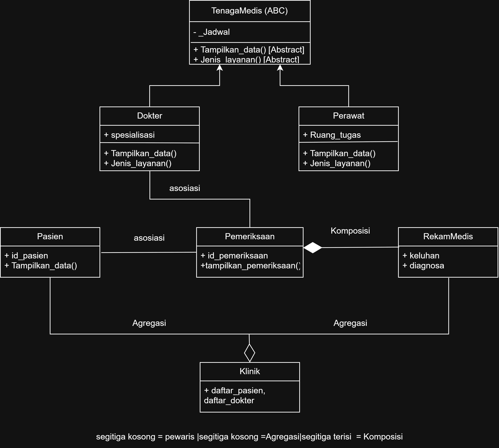

### 3.1 Penjelasan kelas pada diagram

- **`Pasien`** menyimpan data pasien seperti ID, nama, umur, alamat, dan nomor telepon. Nomor telepon disimpan sebagai atribut privat dan diakses melalui property.
- **`TenagaMedis`** adalah abstract class atau kelas induk untuk tenaga medis. Kelas ini mendefinisikan method yang wajib diimplementasikan oleh kelas turunannya.
- **`Dokter`** merupakan subclass `TenagaMedis`. Kelas ini memiliki atribut khusus `spesialisasi` dan menampilkan data dokter.
- **`Perawat`** merupakan subclass `TenagaMedis`. Kelas ini memiliki atribut khusus `ruang_tugas` dan menampilkan data perawat.
- **`Pemeriksaan`** menyimpan ID pemeriksaan, referensi ke pasien dan dokter, biaya, serta objek `RekamMedis`.
- **`RekamMedis`** menyimpan keluhan dan diagnosis pasien yang berkaitan dengan suatu pemeriksaan.
- **`Klinik`** menyimpan daftar objek pasien dan dokter yang dimasukkan ke dalam klinik.
- **`Notifikasi`** dan **`Pembayaran`** adalah dua kelas berbeda yang sama-sama memiliki method `proses()`. Keduanya digunakan untuk menunjukkan konsep duck typing.

### 3.2 Association (Asosiasi)

**Asosiasi** adalah hubungan ketika suatu objek menggunakan atau berhubungan dengan objek lain. Pada program ini, `Pemeriksaan` memiliki atribut `pasien` dan `dokter`. Nilai kedua atribut tersebut berupa objek yang sudah dibuat sebelumnya.

Contohnya, ketika objek `Pemeriksaan` dibuat, program menerima objek pasien dan dokter sebagai argumen. Informasi nama pasien dan nama dokter kemudian dapat digunakan saat data pemeriksaan ditampilkan. Hubungan ini disebut asosiasi karena pemeriksaan berhubungan dengan objek pasien dan dokter.

### 3.3 Aggregation (Agregasi)

**Agregasi** adalah hubungan keseluruhan dan bagian, tetapi objek bagian masih dapat berdiri sendiri. Pada program ini, `Klinik` mempunyai atribut `daftar_pasien` dan `daftar_dokter` yang berupa list.

Objek pasien dan dokter dibuat di luar objek `Klinik`, lalu dimasukkan melalui method `tambah_pasien()` dan `tambah_dokter()`. Artinya, objek pasien dan dokter tidak dibuat sebagai bagian yang wajib hidup hanya selama objek klinik ada. Oleh sebab itu, hubungan `Klinik` dengan `Pasien` dan `Dokter` dijelaskan sebagai agregasi.

### 3.4 Composition (Komposisi)

**Komposisi** adalah hubungan bagian dan keseluruhan yang lebih kuat. Pada program ini, constructor `Pemeriksaan` membuat objek `RekamMedis` secara langsung melalui perintah `RekamMedis(keluhan, diagnosa)` dan menyimpannya pada atribut `rekam_medis`.

Dengan demikian, objek rekam medis dibuat sebagai bagian dari objek pemeriksaan. Inilah dasar penerapan komposisi pada program ini.

### 3.5 Inheritance (Pewarisan)

`Dokter` dan `Perawat` mewarisi kelas `TenagaMedis`. Keduanya memanggil `super().__init__(...)` agar atribut dasar seperti ID tenaga medis, nama, dan jadwal diinisialisasi oleh kelas induk. Setiap subclass juga memiliki atribut khusus masing-masing: `spesialisasi` untuk dokter dan `ruang_tugas` untuk perawat.

---

## 4. Abstraction (Abstraksi)

Abstraksi digunakan untuk menetapkan perilaku umum yang wajib dimiliki kelas turunan, tanpa memberikan implementasi lengkap pada kelas induknya. Dalam program ini, abstraksi diterapkan melalui `TenagaMedis` dengan menggunakan `ABC` dan decorator `@abstractmethod` dari modul `abc`.

### 4.1 Abstract class `TenagaMedis`

`TenagaMedis` merupakan kelas abstrak karena mewarisi `ABC`. Kelas ini mempunyai dua abstract method:

1. **`tampilkan_data()`** — wajib diimplementasikan oleh setiap subclass untuk menampilkan data tenaga medis.
2. **`jenis_layanan()`** — wajib diimplementasikan oleh setiap subclass untuk menjelaskan layanan yang diberikan.

Kelas ini juga memiliki method konkret **`tampilkan_ringkas()`**. Method tersebut sudah mempunyai isi dan memanggil `jenis_layanan()` untuk menampilkan nama, jadwal, dan jenis layanan tenaga medis.

### 4.2 Subclass yang menerapkan abstraksi

- **`Dokter`** mengimplementasikan `tampilkan_data()` untuk menampilkan ID dokter, nama, spesialisasi, jadwal, dan nomor izin. Method `jenis_layanan()` mengembalikan informasi layanan dokter sesuai spesialisasinya.
- **`Perawat`** mengimplementasikan `tampilkan_data()` untuk menampilkan ID perawat, nama, jadwal, dan ruang tugas. Method `jenis_layanan()` mengembalikan informasi layanan perawat sesuai ruang tugasnya.

Kedua subclass tersebut mengimplementasikan seluruh abstract method yang diwajibkan oleh `TenagaMedis`, sehingga objek `Dokter` dan `Perawat` dapat dibuat.

### 4.3 Bukti abstract class tidak dapat dibuat menjadi objek

Pada bagian pengujian, program mencoba menjalankan `TenagaMedis("TM001", "Contoh", "08.00 - 16.00")` di dalam blok `try-except`. Python menolak pembuatan objek karena abstract method belum diimplementasikan pada kelas tersebut. Kesalahan ditangkap sebagai `TypeError`, lalu jenis dan pesan kesalahannya ditampilkan.

Penggunaan `try-except` membuat program dapat melanjutkan pengujian tanpa berhenti karena kesalahan tersebut. Screenshot bagian ini perlu dimasukkan sebagai bukti bahwa `TenagaMedis` benar-benar merupakan abstract class.

---

## 5. Polymorphism (Polimorfisme)

Polimorfisme berarti satu antarmuka atau pemanggilan method dapat menghasilkan perilaku berbeda sesuai objek yang menjalankannya. Program ini menunjukkan tiga bentuk yang diminta.

### 5.1 Polimorfisme melalui inheritance

Kelas `Dokter` dan `Perawat` sama-sama mempunyai method `tampilkan_data()` karena keduanya merupakan turunan `TenagaMedis`. Namun, isi method tersebut berbeda: dokter menampilkan spesialisasi dan nomor izin, sedangkan perawat menampilkan ruang tugas.

Dalam pengujian, objek dokter dan perawat dimasukkan ke satu list bernama `daftar_tenaga_medis`. Program menjalankan satu perulangan `for` dan memanggil `tampilkan_data()` untuk setiap objek. Walaupun pemanggilan method-nya sama, hasil yang ditampilkan mengikuti jenis objeknya. Inilah polimorfisme melalui inheritance dan method overriding.

### 5.2 Duck typing

Duck typing adalah pendekatan ketika suatu fungsi menggunakan method yang tersedia pada objek, tanpa harus memeriksa kelas atau tipe objek tersebut terlebih dahulu.

Pada program ini, kelas `Notifikasi` dan `Pembayaran` tidak mempunyai hubungan pewarisan satu sama lain. Akan tetapi, keduanya mempunyai method dengan nama yang sama, yaitu `proses()`.

Fungsi `jalankan_proses(objek)` hanya memanggil `objek.proses()`. Fungsi tersebut digunakan untuk objek `Notifikasi` dan `Pembayaran` melalui satu perulangan. `Notifikasi` menampilkan pesan untuk pasien, sedangkan `Pembayaran` menampilkan informasi pembayaran. Program tidak menggunakan pemeriksaan tipe objek dengan rangkaian `if/elif`; perilaku ditentukan oleh method yang dimiliki masing-masing objek.

### 5.3 Operator overloading

Operator overloading memungkinkan perilaku operator atau operasi bawaan ditentukan untuk objek dari suatu kelas. Program ini menerapkannya melalui method khusus `__str__()` pada kelas `RekamMedis`.

Method `__str__()` menghasilkan teks yang merangkum keluhan dan diagnosis. Karena itu, ketika objek rekam medis diberikan langsung kepada `print()`, Python menampilkan teks yang dibuat oleh `__str__()`, bukan representasi objek standar. Contoh pengujiannya adalah `print(daftar_pemeriksaan[0].rekam_medis)`.

---

## 6. Konsep OOP Pendukung

### 6.1 Class dan object

Class adalah cetak biru untuk membuat objek. Contohnya, `Pasien` adalah class, sedangkan data pasien yang dibuat melalui `Pasien(...)` merupakan objek. Konsep yang sama digunakan pada `Dokter`, `Perawat`, `Pemeriksaan`, dan kelas lainnya.

### 6.2 Atribut dan method

Atribut menyimpan data suatu objek, misalnya `nama`, `umur`, `spesialisasi`, `ruang_tugas`, `keluhan`, dan `diagnosa`. Method adalah fungsi yang berada di dalam class, misalnya `tampilkan_data()`, `tampilkan_pemeriksaan()`, dan `tambah_pasien()`.

### 6.3 Enkapsulasi, getter, dan setter

Enkapsulasi digunakan untuk membatasi akses langsung ke data tertentu dan menyediakan cara pengaksesan yang terkontrol. Contohnya:

- `Pasien` menyimpan nomor telepon pada atribut privat `__no_telepon`, lalu menyediakan property `no_telepon` untuk membaca dan mengubahnya. Setter memeriksa agar nomor tidak kosong, hanya berisi angka, dan panjangnya 10–13 digit.
- `Dokter` menyimpan nomor izin pada atribut privat `__no_izin`. Setter memeriksa agar nomor izin tidak kosong dan diawali dengan `SIP-`.
- `Pemeriksaan` menyimpan biaya pada atribut privat `__biaya`. Setter menolak biaya yang bernilai negatif.
- `TenagaMedis` menggunakan `_jadwal` sebagai atribut protected secara konvensi Python, dan menyediakan property `jadwal` untuk mengakses serta memvalidasi perubahan jadwal.

### 6.4 Class method dan static method

**Class method** menggunakan decorator `@classmethod` dan menerima parameter `cls`, sehingga dapat bekerja dengan kelas. Contohnya adalah `Pasien.tambah_pasien()`, `Dokter.ubah_jam_operasional()`, dan `Pemeriksaan.ubah_biaya_konsultasi()`.

**Static method** menggunakan decorator `@staticmethod` dan tidak membutuhkan parameter otomatis `self` atau `cls`. Contohnya adalah `Pasien.validasi_umur()`, `Dokter.validasi_jadwal()`, dan `Pemeriksaan.hitung_total()`.

---

## 7. Cara Menjalankan Program

Pastikan Python 3 sudah terpasang pada komputer.

1. Letakkan file `posttest3_2509106119_AhmadArilFadillah.B.py`, `README.md`, dan `class_diagram_smart_clinic.svg` di dalam folder proyek yang sama.
2. Buka terminal atau Command Prompt pada folder tersebut.
3. Jalankan perintah berikut:

```bash
python posttest3_2509106119_AhmadArilFadillah.B.py
```

4. Program akan menjalankan bagian pengujian OOP terlebih dahulu.
5. Baca hasil pengujian pada terminal, kemudian tekan tombol yang diminta program untuk melanjutkan ke menu utama.
6. Gunakan menu yang tersedia untuk melihat dan mengelola data.

Jika perintah `python` tidak dikenali pada Windows, coba gunakan:

```bash
py posttest3_2509106119_AhmadArilFadillah.B.py
```

## 8. Panduan Pengujian dan Screenshot

### 8.1 Pengujian abstract class
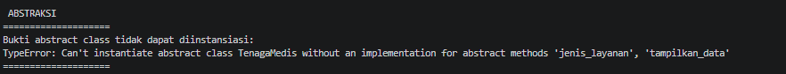

### 8.2 Pengujian inheritance dan method overrid
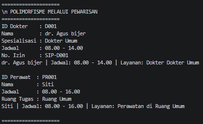

### 8.3 Pengujian duck typing
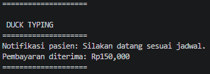

### 8.4 Pengujian operator overloading
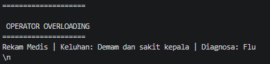

### 8.5 Pengujian relasi objek
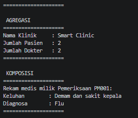

### 8.6 Pengujian menu dan CRUD
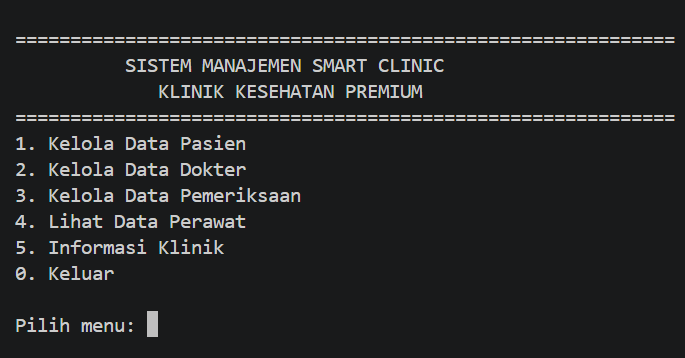

### 8.7 CRUD pasien
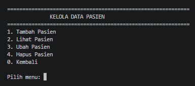
### 8.8 CRUD dokter
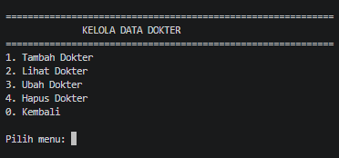
### 8.9 CRUD data pemeriksaan
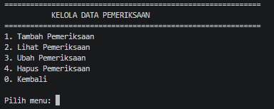
### 8.10 CRUD data perawat
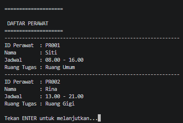
### 8.11 info klinik
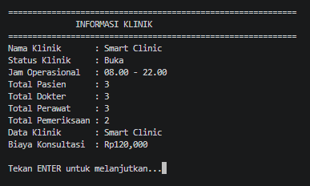
---

## 9. Ringkasan Penerapan Konsep

| Konsep | Penerapan dalam program |
|---|---|
| Class dan object | `Pasien`, `Dokter`, `Perawat`, `Pemeriksaan`, dan objek-objeknya |
| Association | `Pemeriksaan` menyimpan referensi ke objek `Pasien` dan `Dokter` |
| Aggregation | `Klinik` mengumpulkan objek `Pasien` dan `Dokter` yang dibuat dari luar |
| Composition | `Pemeriksaan` membuat objek `RekamMedis` di dalam constructor |
| Inheritance | `Dokter` dan `Perawat` mewarisi `TenagaMedis` |
| Abstraction | `TenagaMedis` menggunakan `ABC` dan dua `@abstractmethod` |
| Polimorfisme inheritance | `tampilkan_data()` mempunyai implementasi berbeda pada `Dokter` dan `Perawat` |
| Duck typing | `Notifikasi` dan `Pembayaran` diproses oleh `jalankan_proses()` melalui method `proses()` |
| Operator overloading | `RekamMedis.__str__()` menentukan teks saat objek diberikan ke `print()` |
| Enkapsulasi | Atribut privat, property, getter, setter, dan validasi data |
| Class method | Method yang menggunakan `@classmethod` |
| Static method | Method validasi/perhitungan yang menggunakan `@staticmethod` |

## 10. Kesimpulan

Program Sistem Manajemen Smart Clinic digunakan sebagai contoh penerapan pemrograman berorientasi objek dalam kasus pengelolaan klinik. Selain pengelolaan data melalui menu terminal, program menunjukkan hubungan antarkelas, pewarisan, abstraksi menggunakan abstract class, dan polimorfisme dalam tiga bentuk, yaitu inheritance polymorphism, duck typing, serta operator overloading.

Bukti pengujian pada terminal dan class diagram UML perlu disertakan bersama kode agar pembaca dapat memeriksa hubungan antara penjelasan dan implementasi program.
